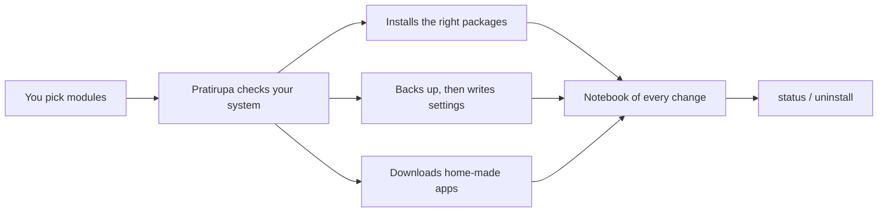

<div align="center">

<h1>🪞 Pratirupa</h1>

<h4>Set up a new Linux computer the way you like it, with one command.</h4>

<a href="https://github.com/sudharamachandranrajeev/pratirupa-linux-setup/releases"></a>

<a href="LICENSE"></a>


<p>
  <a href="#-what-it-does">What it does</a> •
  <a href="#-get-started">Get started</a> •
  <a href="#-how-it-works">How it works</a> •
  <a href="#-faq-and-troubleshooting">FAQ</a> •
  <a href="#%EF%B8%8F-for-developers">For developers</a>
</p>

</div>

Pratirupa ("replica") takes a hand-tuned [Omarchy](https://omarchy.org) laptop and replays
its extra apps, settings, services, themes and home-made tools on another Linux machine. It
works fully on Omarchy, mostly on any Arch-based system, and installs a portable subset on
Debian, Ubuntu, Fedora and openSUSE. Anything that cannot work on your system is skipped with
a note, never forced. Status: **alpha**.

## ✨ What it does

- 🧩 **Pick what you want** – a checklist of modules; untick anything you do not need.
- 📦 **Right package for your system** – one list maps each app to pacman, the AUR, apt, dnf,
  zypper or Flathub, whichever your system can use.
- 🔐 **Safer by default** – firewall on, an app-level firewall (OpenSnitch), Tailscale and
  Syncthing ready, nothing logged in for you.
- 🛠️ **Developer tools** – Rust and Tauri, Flutter, Node, Python (uv), GitHub CLI, Docker,
  Android tools and a local AI runner (Ollama) matched to your graphics card.
- 🎨 **Themes and bar widgets** – the Halloween Night, Monograph, Christmas 2026 and Clinical
  themes, the Theme Customiser, and widgets for battery, storage, AI usage and network.
- 🖐️ **Touchpad and shortcuts** – natural scrolling, three- and four-finger gestures and extra
  key bindings on Hyprland.
- 📺 **Home-made tools** – cast the screen to a TV, stay awake while media plays, play sound
  on two Bluetooth headphones at once.
- ↩️ **Undo** – every file it replaces is backed up first, and `uninstall` puts it back.
- 👀 **Dry run** – see every step before anything changes.

<details>
<summary><b>All modules and where they work</b></summary>

| Module | What it sets up | Works on |
| --- | --- | --- |
| `dev-toolchain` | Rust + Tauri, Flutter, Node, uv Python, gh/glab, Docker, Android tools, rizin/Ghidra, Ollama | any |
| `apps-extra` | Browsers, Ghostty, VS Code, OBS, Kdenlive, VLC, Steam, chat, mail and more | any |
| `services-security` | ufw, OpenSnitch, Tailscale (not logged in), Syncthing, vnstat, SMART tools | any |
| `own-apps` | Home-made apps from their GitHub releases (Paattu, Gaṇanā, Chanda, Vastra and more) | any |
| `own-scripts` | Two-headphone audio; on Omarchy also TV casting and stay-awake | any (part Omarchy) |
| `desktop-portal` | Fixes "sign-in won't be saved" in Chromium and Electron apps | Hyprland |
| `desktop-hyprland` | Touchpad, gestures, key bindings, terminal font size | Omarchy |
| `omarchy-themes` | Themes and the Theme Customiser | Omarchy |
| `omarchy-plugins` | Bar widgets | Omarchy |

</details>

## 🚀 Get started

**1. Open a terminal** as your normal user (not root).

**2. Paste this line** and press Enter:

```bash
curl -fsSL https://raw.githubusercontent.com/sudharamachandranrajeev/pratirupa-linux-setup/main/setup.sh | bash
```

It downloads Pratirupa to `~/.local/share/pratirupa` and opens the module list.

**3. Choose modules.** Every module that fits your system starts ticked. Press Space to
untick one, then Enter. Modules that cannot work on your system are left out;
`./setup.sh list` shows why.

**4. Type your password** when asked. Only modules that install packages ask for it.

**5. Read the summary.** It lists anything skipped and any step left for you, such as
`sudo tailscale up` to log in to Tailscale.

> [!TIP]
> Not sure? Run `~/.local/share/pratirupa/setup.sh --dry-run install` first. It prints every
> step and changes nothing.

<details>
<summary><b>Prefer to clone it yourself</b></summary>

```bash
git clone https://github.com/sudharamachandranrajeev/pratirupa-linux-setup.git
cd pratirupa-linux-setup
./setup.sh list                 # what fits this machine
./setup.sh install apps-extra   # one module
./setup.sh                      # the checklist
```

</details>

<details>
<summary><b>Every command</b></summary>

| Command | What it does |
| --- | --- |
| `./setup.sh` | Show the checklist and install what you tick |
| `./setup.sh install [MODULE…]` | Install the named modules (all that fit, if none named) |
| `./setup.sh list` | Show every module and whether it fits this machine |
| `./setup.sh status [MODULE]` | Show what was installed and what you changed since |
| `./setup.sh uninstall MODULE…` | Put back the files a module replaced |
| `--dry-run` | Show what would happen, change nothing |
| `--yes` | Do not ask; take the default answers |
| `--allow-remote-scripts` | Let modules run third-party installers (Tailscale, mise) without asking |

</details>

## 🧭 How it works



- It reads `/etc/os-release` to learn your system family, and checks for Omarchy and Hyprland.
- Each app has one row in a package list with the name to use on each family.
- Before it replaces a file, it saves the original. Settings it adds to files you own go in a
  clearly marked block, so your own lines stay untouched.
- Every change is written to a notebook (`~/.local/state/pratirupa/ledger.tsv`). `status`
  and `uninstall` read it.

## 🔒 Your data

- **Never copied:** passwords, keys, browser profiles, logins, chat history or anything from
  your home folder. Pratirupa only brings settings that are safe to share.
- **Not logged in for you:** Tailscale, Syncthing and the apps start signed out.
- **Downloads are checked:** apps come from their official GitHub releases. When a release
  publishes a checksum file, a download that does not match it is refused. Repos are fetched
  at their newest release tag and reset to it before anything runs.
- **No surprise installers:** third-party install scripts (Tailscale, mise) run only after you
  say yes. `--yes` skips them unless you also pass `--allow-remote-scripts`.
- **Firewall openings stay local:** screen casting opens its ports to home and office
  (private) networks only, and `uninstall own-scripts` closes them again.
- **Backups:** originals are kept in `~/.local/state/pratirupa/backup/`. If you edit a managed
  file and run Pratirupa again, your edited copy is kept there too.

- **Edits are kept:** if you changed a file Pratirupa manages, `uninstall` saves your copy
  before putting the original back. Files you already had are never deleted.

> [!IMPORTANT]
> `uninstall` restores files and turns off services, but it does not remove packages. Remove
> those with your package manager if you no longer want them.

> [!NOTE]
> On Arch, apps from the AUR are built without stopping to show you their build script, as
> AUR helpers do with `--noconfirm`. A `--dry-run` lists every AUR package first.

## ❓ FAQ and troubleshooting

<details>
<summary><b>A module is missing from the checklist</b></summary>

It needs Omarchy or Hyprland and your system does not have it. `./setup.sh list` says which.
</details>

<details>
<summary><b>The summary says a package "is not available"</b></summary>

Your system's repositories do not offer it. On Debian, Ubuntu, Fedora and openSUSE many apps
come from Flathub instead; Pratirupa adds Flathub when it needs to.
</details>

<details>
<summary><b>Steam was skipped on Arch</b></summary>

Steam needs the `[multilib]` repository. Turn it on in `/etc/pacman.conf`, run
`sudo pacman -Sy`, then install `apps-extra` again.
</details>

<details>
<summary><b>Docker says "permission denied"</b></summary>

Add yourself to the docker group with `sudo usermod -aG docker $USER`, then log out and in.
</details>

<details>
<summary><b>I changed a setting and want Pratirupa's version back</b></summary>

Run `./setup.sh status` to see what changed, then install that module again. Your edited copy
is saved in the backup folder first.
</details>

<details>
<summary><b>Can I run it twice?</b></summary>

Yes. Anything already in place is left alone.
</details>

## 🛠️ For developers

<details>
<summary><b>Layout, tests and tools</b></summary>

- `core/pratirupa.sh` – the shared library: detection, packages, backed-up file writes,
  marked blocks, services, GitHub releases, the ledger.
- `core/packages.map` – one row per app: `name arch debian fedora suse`.
- `modules/<name>/module.sh` – sets `MOD_DESC`, `MOD_TIER`, `MOD_ROOT` and defines
  `mod_apply` (and `mod_remove` if it needs more than the ledger).

```bash
tests/core-test.sh         # library and file modules, in a throwaway home folder
tests/containers.sh        # clean Arch, Debian, Ubuntu, Fedora and openSUSE containers
tools/leak-scan.sh         # personal-data scan; run before every commit
./setup.sh capture         # on Omarchy: what this machine has that the modules miss
```

`capture` only prints a report. Keep any saved copy outside the repo, and scrub anything you
move into a module.

</details>

## License

[MIT](LICENSE)

> GitHub [@sudharamachandranrajeev](https://github.com/sudharamachandranrajeev)
